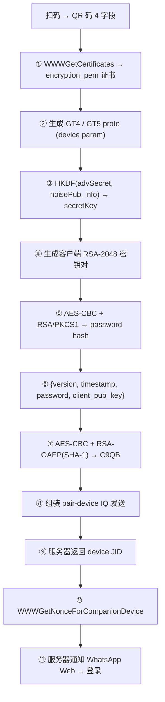

# Pair-Device Encryption Protocol — Implementation Status

> **Date**: 2026-07-10  
> **Tag**: `v0.10.0` (pre-implementation stable), current WIP  
> **Branch**: `dev`

---

## 1. Overview

WhatsApp 升级了 QR 码多设备配对协议，新增了密码学验证层。companion 设备扫码后需发送 `<pem>` 和 `<encryption-metadata>` 字段，随后通过 `WWWGetNonceForCompanionDevice` 完成 nonce 交换，服务器才会通知主端（WhatsApp Web）配对成功。

本文档梳理当前实现进度、遗留问题和后续方向。

---

## 2. 数据流 (Data Flow)



### 2.1 各步骤详情

| Step | 操作 | 关键算法 | 状态 |
|------|------|---------|------|
| ① | WWWGetCertificates | GraphQL query_id: `25094190163544446` | ✅ 实现 |
| ② | 生成 GT4/GT5 | GTF→GTB→HMAC, ADVSignedKeyIndexList | ✅ 实现 |
| ③ | 派生 secretKey | `HKDF-SHA256(salt=noisePub, ikm=advSecret, info="Canonical Ent Companion Nonce Encrypt", L=32)` | ✅ |
| ④ | 生成 RSA 密钥对 | `KeyPairGenerator RSA 2048` | ✅ |
| ⑤ | Password hash | `AES-CBC(advSecret) + RSA/PKCS1(client_pub)` → hex blob | ✅ |
| ⑥ | Plaintext JSON | `{version, timestamp, password, client_pub_key(PEM), client_pub_key_type}` | ✅ |
| ⑦ | 加密 plaintext | `AES-CBC + RSA-OAEP(SHA-1)` with `encryption_pem` cert | ✅ |
| ⑧ | 发送 pair-device IQ | XMPP xmlns `md`, 含 `<pem>`, `<encryption-metadata>`, `<client-props>` | ✅ |
| ⑨ | 接收 result | 服务器返回 `<companion-props>` + `<device jid>` | ✅ |
| ⑩ | WWWGetNonceForCompanionDevice | 发送 `encrypted_password` 证明 | ❌ 未完成 |
| ⑪ | 服务器通知主端 | — | 被 ⑩ 阻塞 |

---

## 3. 文件清单

| 文件 | 用途 | 状态 |
|------|------|------|
| `proto/wa_struct.proto` | 新增 GTF/GTB/GT4/GT5/GTH 定义 | ✅ |
| `proto/qr_pair_device.py` | 手动 protobuf 编码（GTF→GT4, GTH） | ✅ |
| `app/layer/qr_crypto.py` | HKDF, AES-CBC, RSA-OAEP, RSA keygen, password hash | ✅ |
| `core/layers/.../iq_md_pair_device.py` | pair-device IQ 协议实体 (支持 pem, encryption-metadata) | ✅ |
| `common/utils.py` | 新增 `generateMultiDeviceParams` | ✅ |
| `app/zowbot_cmd/md/md_link.py` | 主流程 (扫码 → 加密 → IQ → nonce) | ✅ + WIP |
| `app/zowbot_cmd/misc/misc_wwwgetcertificates.py` | WWWGetCertificates 单独命令 | ✅ |

---

## 4. XML 结构 (pair-device IQ)

```xml
<iq to="s.whatsapp.net" type="set" xmlns="md">
  <pair-device>
    <ref>base64_QR_field_1</ref>
    <pub-key>noisePub_base64</pub-key>
    <device-identity>GT4_protobuf</device-identity>
    <key-index-list ts="epoch">GT5_protobuf</key-index-list>
    
    <!-- v0.11+ 新字段 -->
    <client-props>GTH_protobuf</client-props>
    <pem version="1" algorithm="rsa2048">
      <pem>secretKey_base64</pem>
      <ttl ts_s="432000"/>
      <key_id>1</key_id>
    </pem>
    <encryption-metadata version="1" algorithm="rsa2048">
      <encrypted_key>RSA-OAEP(AES_key)_base64</encrypted_key>
      <nonce>12B_IV_base64</nonce>
      <encrypted_data>AES-CBC(plaintext_json)_base64</encrypted_data>
      <auth_tag>last_CBC_block_base64</auth_tag>
    </encryption-metadata>
  </pair-device>
</iq>
```

---

## 5. 算法参考 (来自 APK 反编译)

### 5.1 secretKey 派生

```java
// AbstractC40168HpI.A01 + AbstractC34831gk.A02
SecretKeySpec = HKDF-SHA256(
    salt  = companion_noise_pub,      // QR 字段 2
    ikm   = adv_secret,               // QR 字段 4 (32 bytes)
    info  = "Canonical Ent Companion Nonce Encrypt",
    L     = 32
)
```

### 5.2 Password Hash

```java
// C40268Hr6.A01
password_hash = hex(
    [version=1] [key_type] [12B IV] 
    [2B LE encrypted_key_len] [RSA/PKCS1(AES_key)] 
    [16B last_CBC_block] [CBC_ciphertext_remainder]
)
// Used as: "#PWD_WA:11:{timestamp}:{password_hash}"
```

### 5.3 Encryption-Metadata

```java
// C40268Hr6.A05 (rsa2048 else branch)
AES_key  = random(32)
IV       = random(12)
ciphertext = AES-CBC(plaintext_json, AES_key, IV)
encrypted_key = RSA-OAEP-SHA1(AES_key, encryption_pem_pubkey)

split: ciphertext[:len-16], ciphertext[-16:] → enc_data, auth_tag
```

### 5.4 密钥类对照

| Java | Python | 作用 |
|------|--------|------|
| `C9Q9` | — | 内部加密结果 (A01=encKey, A02=IV, A00=encData, A03=authTag) |
| `C9QB` | — | XML 序列化版本 (A02=encKey, A03=nonce, A01=encData, A00=authTag) |
| `C40268Hr6` | `qr_crypto.py` | 加密工具类 |
| `AbstractC40168HpI` | `qr_crypto.derive_secret_key()` | secretKey 派生 |
| `AbstractC40142Hor` | `qr_crypto` | RSA 密钥生成 + PEM 序列化 |
| `AbstractC34831gk` | `common/utils.Utils.expand()` | HKDF expand 步骤 |

---

## 6. Proto 类型

| 类型 | 对应 Java | 字段 | 实现 |
|------|-----------|------|------|
| GTF | DeviceIdentity | rawId(1), timestamp(2), keyIndex(3), deviceType(4), accountType(5) | `proto/qr_pair_device.py` |
| GTB | SignedDeviceIdentity | details=GTF(1), sigKey(2), sig(4) | `proto/qr_pair_device.py` |
| GT4 | SignedDeviceIdentityHMAC | details=GTB(1), hmac(2), accountType(4) | `proto/qr_pair_device.py` |
| GT5 | = ADVSignedKeyIndexList | details(1), sig(2) | 复用 `wa_struct_pb2` |
| GTH | ClientProps | 5 bools + optional bytes | `proto/qr_pair_device.py` |

---

## 7. 遗留问题 & 下一步

### 7.1 已修复问题 (2026-07-14 真机抓包对比)

| # | 问题 | 修复 | 状态 |
|---|------|------|------|
| 1 | **加密模式错误** — 代码用 AES-CBC，真机用 AES-GCM | `qr_crypto.py` 改为 AES-GCM (12B nonce + 16B tag) | ✅ 已修复 |
| 2 | **challenges 未发送** — 真机发送 `<friction variant='1'/>` + `<passkey-create/>` | `md_link.py` 启用 challenges | ✅ 已修复 |
| 3 | **nonce_encryption_key 编码错误** — 代码单层 base64，真机双层 base64 | `md_link.py` 改为 `base64(base64(key) + newline)` | ✅ 已修复 |
| 4 | **fbid 为空** — 真机传 16 位数字 (如 `1047219231815734`) | `md_link.py` 改为从 `_fbid` 属性读取，空时告警 | ⚠️ 需获取 fbid |

### 7.2 加密模式确认依据

真机抓包数据 (bytes 层面分析):
- pair-device: encrypted_data=1035B, auth_tag=16B, nonce=12B → 1035 % 16 = 11 → **非 CBC，必须是 GCM**
- nonce query: data=1047B, tag=16B, nonce=12B → 1047 % 16 = 7 → **非 CBC，必须是 GCM**
- AES-GCM: ciphertext = plaintext 长度 (无 padding)，12B nonce，16B tag
- AES-CBC: ciphertext 必须是 16 的倍数 (有 padding)

### 7.3 fbid 来源 (已确认 2026-07-14)

`fbid` 是 WhatsApp 账号关联的 Facebook ID (long 类型)。

**APK 逆向确认**:
- 存储在 `CanonicalEntCredentialStore` 的 SharedPreferences 中
- SharedPreferences keys: `fb_id`(long), `access_token`, `password`, `timestamp_ms`, `ttl_seconds`, `analytics_claim`, `user_lid`
- 数据类: `C15460ny` (CanonicalEntCredentials): fbId, accessToken, password, timestampMs, ttlSeconds, analyticsClaim

**获取流程**:
1. 发送 `PeerDataOperationRequestMessage` (type=16) 含 `CompanionCanonicalUserNonceFetchRequest`
2. 收到 `PeerDataOperationRequestResponseMessage` (type=17) 含 `CompanionCanonicalUserNonceFetchResponse`
3. 从 response 中提取 `waFbid` 字段
4. 存储 `waFbid` 作为 `fb_id`

**实现状态**:
- ✅ `pairing.py`: `fetch_wa_fbid()` 方法发送请求
- ✅ `message_handler.py`: 解析响应并提取 `waFbid`
- ✅ `converter.py`: `protocol_to_proto` 支持 `peer_data_operation_request_message`
- ✅ `md_link.py`: md.link 开始时自动调用 `fetch_wa_fbid()`
- ⚠️ `fetch_wa_fbid` 通过 E2E 发给自己收到 error 479，无法获取

### 7.3.1 CanonicalEntCredentials 完整流程 (2026-07-14 APK 逆向确认)

**APK 类链路**:
```
G57 (WWWCreateUser/WWWCreateAccessToken)
  → C3h(): WWWCreateUser — 创建 canonical user
    1. 生成 RSA key pair
    2. 生成随机 password (JJ5.A00)
    3. 构建 PWD_WA hash: ID8.A02(keyId, password, null, publicKey)
       → "#PWD_WA:11:{timestamp}:{hash}"
    4. 构建 JSON: {timestamp, password, client_pub_key}
    5. 用 x509 证书加密 (AES-GCM + RSA-OAEP)
    6. 发送 WWWCreateUser: {encrypted_password, timestamp, use_case}
    7. 服务器返回 fb_id

C40074Hmy (AuthProofHelper)
  → A00(): 读取存储的 credentials，构建 encrypted_password
  → A01(): password = PWD_WA hash of STORED password (不是 adv_secret)
    JSON: {version, timestamp, password, client_pub_key, client_pub_key_type}
    注意：没有 did 字段！

C12830ig (FBCredentialsStore)
  → A05(): 读取 credentials
    canonical (C12570iF.A04) → 使用 C15400ns (独立存储)
    其他 (DIGITAL_COMMERCE等) → 使用加密 SharedPreferences
  → A0C(): 存储 credentials
    canonical → C15400ns.A05(C15460ny)
  → A01(): C15470nz → C15460ny 转换
    fbId = credentials.A04.A00 (long)
    password = credentials.A05.A00 (string)
    accessToken = credentials.A02.A00 (string)

CompanionCanonicalUserNonceManager
  → A00(): 执行 WWWGetNonceForCompanionDevice
    fbid = stored credentials.fb_id
    encrypted_password = C40074Hmy.A00() (加密存储的 password)
    nonce_encryption_key = base64(base64(random_key) + newline)
```

**关键结论**:
1. `WWWGetNonceForCompanionDevice` 的 `encrypted_password` 是对**存储的 CanonicalEntCredentials.password** 的加密
2. **不是**对 pair-device 的 adv_secret plaintext JSON 的加密
3. `fbid` 来自 `WWWCreateUser` 返回的 `fb_id`，持久化存储
4. `canonical` use_case 有独立的存储 (C15400ns / CanonicalEntCredentialStore)
5. zowsup 账号从未通过 `WWWCreateUser` 创建 canonical user，所以没有 credentials

**解决方案**:
需要先调用 `WWWCreateUser` (use_case="CANONICAL") 创建 canonical user，获取 fb_id + password，
然后才能调用 `WWWGetNonceForCompanionDevice`。

### 7.3.2 WWWCreateUser 完整实现细节 (2026-07-14 APK 逆向确认)

**随机 password 生成 (JJ5.A00)**:
```python
# 50 个随机字符，从以下字符集选取:
charset = "ABCDEFGHIJKLMNOPQRSTUVWXYZabcdefghijklmnopqrstuvwxyz0123456789!@#$%^&*()_+{}"
password = "".join(random.choice(charset) for _ in range(50))
```

**PWD_WA hash 构建 (ID8.A02 + ID8.A08)**:
```python
# ID8.A02(keyId, password, null, publicKey):
# 1. 生成随机 AES-256 key
# 2. 生成 12-byte IV
# 3. AES-GCM encrypt(password_bytes, aes_key, iv) → ciphertext + 16-byte tag
# 4. Split: ciphertext[:-16], tag = last 16 bytes
# 5. RSA/PKCS1 encrypt(aes_key, publicKey)
# 6. Blob: [1][key_type][iv(12)][encKeyLen(2 LE)][encKey(256)][tag(16)][ciphertext]
# 7. Return base64(blob)

# ID8.A08 wrapper:
# "#PWD_WA:11:{timestamp}:{base64_blob}"
```

**注意**: `ID8.A02` 使用 AES-GCM 但**拆分 ciphertext 和 tag**（和 `build_password_hash` 一致）。
RSA 使用 **PKCS1Padding**（不是 OAEP）。

**plaintext 加密 (ID8.A06)**:
```python
# 根据 x509 证书的 RSA key 大小:
# If RSA >= 4096: AES-GCM(16-byte IV) + RSA-OAEP-SHA256, AAD=DER pubkey
# Else (RSA 2048): AES-GCM(12-byte IV) + RSA-OAEP(SHA1), no AAD
# Returns: C39536HdS(encrypted_key, ciphertext, tag, iv)
```

**WWWCreateUser 请求参数**:
```json
{
  "encrypted_password": {
    "algorithm": "rsa2048",
    "key": "base64(encrypted_key)",
    "data": "base64(ciphertext)",
    "tag": "base64(tag)",
    "nonce": "base64(iv)"
  },
  "timestamp": "1784004160",
  "use_case": "CANONICAL"
}
```

**WWWCreateUser 响应 (Argo)**:
```
data.xwa2_ent_create_ent.encrypted_fbid_and_access_token
  → {key, data, tag, nonce, algorithm}
```
响应是**加密的**，需要用请求时生成的 RSA 私钥解密：
- `ID8.A07(encrypted_response, privateKey)` → 解密得到 JSON
- 解密后的 JSON 包含 `fb_id` 和 `access_token`

**完整实现流程**:
```
1. WWWGetCertificates → 获取 x509 证书
2. 生成 RSA-2048 key pair (用于 WWWCreateUser 的 password encryption)
3. 生成随机 password (50 chars)
4. 构建 PWD_WA hash: ID8.A02(keyId=0, password, null, rsaPublicKey)
   → "#PWD_WA:11:{timestamp}:{base64_blob}"
5. 构建 plaintext JSON: {timestamp, password:PWD_WA_hash, client_pub_key:PEM}
6. 加密 plaintext: ID8.A06(json_string, x509_cert) → {key, data, tag, iv}
7. 发送 WWWCreateUser: {encrypted_password, timestamp, use_case="CANONICAL"}
8. 收到响应: data.xwa2_ent_create_ent.encrypted_fbid_and_access_token
9. 用 RSA 私钥解密响应: ID8.A07(response, rsaPrivateKey) → JSON with fb_id
10. 存储 fb_id + password (随机生成的 password)
11. 后续 WWWGetNonceForCompanionDevice 使用存储的 fb_id + password
```

### 7.4 plaintext 格式确认 (2026-07-14 第二次测试)

真机 plaintext 大小: pair-device=1035B, nonce query=1047B (差 12B)

**通过大小反推确认的 plaintext 结构**:
```json
{"version":"2.26.26.73","timestamp":1784000252,
 "password":"#PWD_WA:11:1784000252:{base64_blob}",
 "client_pub_key":"-----BEGIN PUBLIC KEY-----\n...\n-----END PUBLIC KEY-----\n",
 "client_pub_key_type":"RSA 2048","did":"11"}
```

关键发现:
1. **password 格式**: `#PWD_WA:11:{timestamp}:{base64_blob}` (不是 hex)
2. **blob 编码**: base64 (不是 hex) — 节省 ~212 字节
3. **did 字段**: 设备 ID 作为字符串 (pair-device 时可能没有，nonce query 时有)
4. **PEM 包含尾部换行符**: `-----END PUBLIC KEY-----\n`
5. **完美匹配 1035 字节** (PEM+newline + did='11')

**已修复**:
- `build_password_hash`: 返回 `#PWD_WA:11:{ts}:{base64(blob)}` 格式
- `build_pair_device_plaintext`: 添加 `did` 字段支持

### 7.5 fbid 获取问题 (2026-07-14 第二次测试)

`CompanionCanonicalUserNonceFetchRequest` 通过 PeerDataOperation 发送到自身 LID 时，
收到 ACK error 479 (无法向自己发送 E2E 消息)。

原因: axolotl 层将 PN JID 自动转换为 LID，导致消息发给自己。
真机的 fbid 是在更早的时间点 (注册/首次登录) 获取并持久化存储的。

**当前策略**: 先不依赖 fbid，聚焦修复 plaintext 格式问题。
如果 nonce query 仍因 fbid 为空失败，再考虑其他获取方式。

### 7.5 account_sync 流程修复 (2026-07-14)

**真机流程** (从抓包确认):
```
pair-device result
  → (5秒后) account_sync notification
  → ACK account_sync
  → WWWGetNonceForCompanionDevice (id=05)
  → get encrypt (id=06)  ← 与 nonce query 并行发送
  → nonce result + get encrypt result
  → history sync messages (6条)
  → app state sync patches (critical_block, critical_unblock_low, regular_low, regular_high, regular)
  → presence probe to companion
```

**zowsup 修复**:
1. `md_link.py`: nonce query 不再在 pair-device 后立即发送，改为存储参数
2. `pairing.py`: `handle_account_sync_notification` 中先发送 nonce query，再 get encrypt
3. `notification_handler.py`: 收到 account_sync notification 时立即发送 ACK

### 7.6 次要问题

| # | 问题 | 方向 |
|---|------|------|
| 1 | `get encrypt` 返回 406 | 可能需要 nonce 交换完成后才能获取密钥 |
| 2 | plaintext 格式 (JSON vs protobuf) | 需 APK 分析确认 |
| 3 | fbid 获取方式 | 需实现 CompanionCanonicalUserNonceFetchRequest 或从 config 读取 |
| 4 | account_sync ACK 重复发送 | 检查是否 notification layer 已自动发送 ACK |

---

## 8. 测试记录

| 时间 | 协议 | 结果 |
|------|------|------|
| 19:47 | 旧 (无加密) | pair-device 成功, device 0:2, Web ? |
| 19:50 | 新 (有 pem) | WWWGetCertificates dict parsing 失败 |
| 19:52 | 新 | 仍然是旧格式 tx (bot 未重启) |
| 19:55 | 旧 | pair-device 成功, device 0:3, get encrypt 406 |
| 19:57 | 新 (base64 fix) | Argo 嵌套 dict 未处理 |
| 19:59 | 新 (dict fix) | encryption_pem found, ProtocolTreeNode str 错误 |
| 20:02 | 新 (bytes fix) | ✅ pair-device 带全部新字段成功, device 0:4 |
| 20:16 | 新 + nonce | Internal Server Error, 被断连 |
| 20:06 | 新 w/o challenges | 同 20:02 |

---

## 9. 恢复开发

```bash
# 回退到稳定版本
git checkout v0.10.0

# 当前 WIP（含新协议代码）
# ENABLE_V11_PROTOCOL = True 会触发完整新协议流程
# 入口: app/zowbot_cmd/md/md_link.py
```
